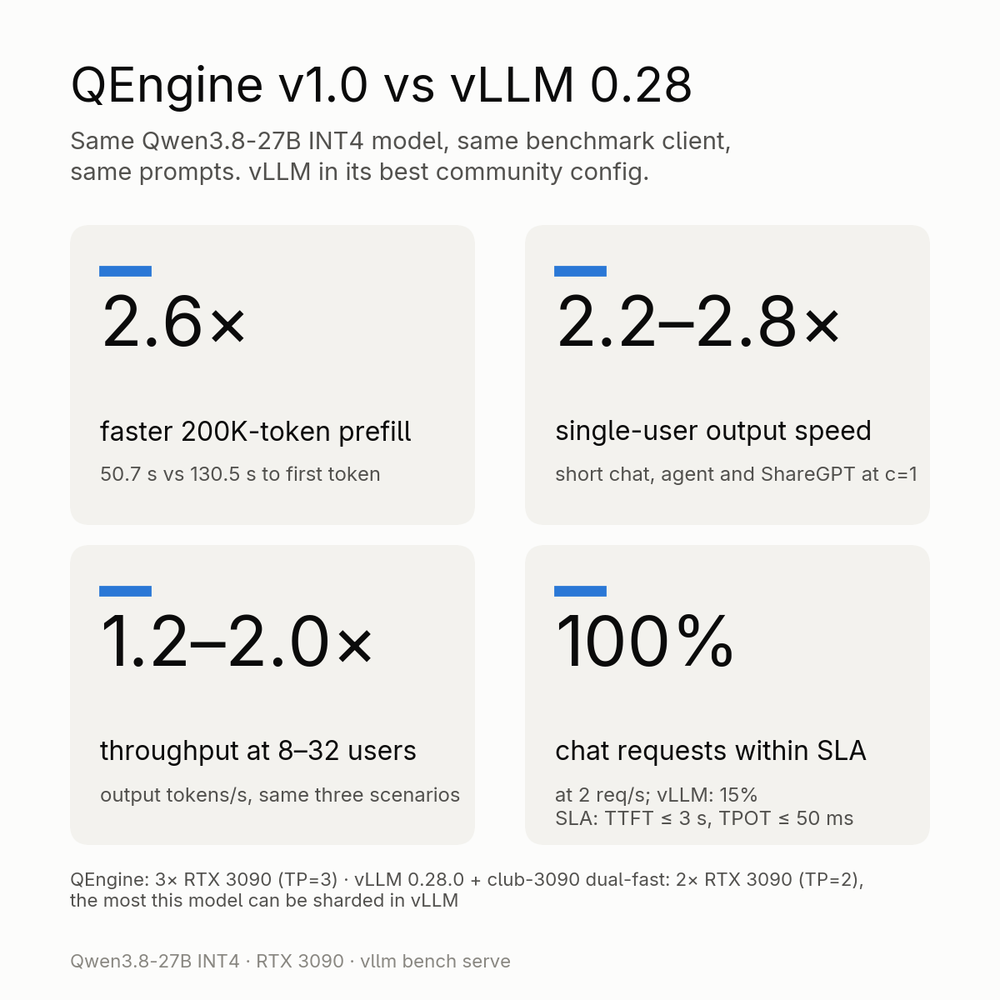

# QEngine

QEngine is a source-available inference engine for one model on one kind of machine:
**Qwen3.8-27B INT4** (the RedHatAI W4A16 checkpoint plus its MTP head) on **three NVIDIA RTX 3090s**
with tensor parallelism 3 over PCIe.

**The fastest engine we know of for this model on RTX 3090s**: 1.2–2.8× vLLM 0.28's output throughput
in our benchmark (see [Benchmark summary](#benchmark-summary)), and well ahead of SGLang, Ollama and LM Studio
in our quick tests.

> **QEngine 1.3.1: Qwen3.8-Flash-Next.** QEngine 1.3.1 runs Qwen3.8-Flash-Next (INT4) on 3 or 2 RTX 3090s, now with
> image input, an opt-in KV cache in host RAM and faster prefill on 2 cards: see [Qwen3.8-Flash-Next](#qwen38-flash-next)
> and the ready-to-run model on [Hugging Face](https://huggingface.co/bpx03/Qwen3.8-Flash-Next-QEngine); the `latest`
> Docker image runs both models.

- C++/CUDA engine (`src/`, about 26k lines), built as a shared library (`libqengine.so`).
- Python server (`server/`) that loads the library through ctypes and exposes an OpenAI-compatible
  API (`/v1/chat/completions`, `/v1/models`) and an Anthropic-compatible API (`/v1/messages`,
  `/v1/messages/count_tokens`). It works with agentic clients such as Claude Code.
  `/v1/models` (and a llama.cpp-style `GET /props`) reports the limits a client needs to size its requests:
  `max_model_len` (prompt + reply tokens of one conversation), `max_num_seqs` (conversations served at once),
  `max_prompt_tokens` (longer prompts get HTTP 400 `context_length_exceeded`), `max_output_tokens` (`null`: no cap
  beyond the context), `kv_pool_tokens` (KV pool of all conversations together), `kv_cache` (`vram` or `ram`) and
  `input_modalities`; `/props` adds `total_slots` and `default_generation_settings.n_ctx`.
- A second engine for **Qwen3.8-Flash-Next**, see [Qwen3.8-Flash-Next](#qwen38-flash-next).

## Hardware requirements and limitations

**Read this first.**

- **Designed and tuned for 3× RTX 3090** (24 GB, sm_86, PCIe 4.0 x16, no NVLink): tensor parallel 3,
  GPUs `0,1,2` by default. The weight and KV-head split, kernels and tuning (82 SMs, tile shapes, split
  counts, wave sizing, memory budgets) target this setup; it is the configuration behind the main
  benchmark.
- **2× RTX 3090 also measured**: 1.2–2.0× vLLM's output throughput on the same two GPUs up to 16
  concurrent requests (short, agent and ShareGPT), at 72–85% of the 3-GPU throughput.
- **1× RTX 3090 is experimental**: it starts only with `QE_MAX_SEQS` ≤ 4 (about 85K–112K tokens of context,
  around 100 tok/s for a single user).
- **Device selection**: `QE_DEVICES=0,2 server/run.sh 8080` (physical GPU ids), `--devices` (indices within
  `CUDA_VISIBLE_DEVICES`), or `QE_GPUS` in Docker. By default every visible GPU is used; counts other than 2 or 3
  start with a warning.
- **sm_86 only**: `CMakeLists.txt` builds for `CMAKE_CUDA_ARCHITECTURES 86`. Other GPU models are untested.
- One model only: Qwen3.8-27B INT4 (RedHatAI compressed-tensors W4A16 layout). Other checkpoints or
  quantizations are not supported.
- Linux only (developed on Fedora 44, kernel 7.2). **Windows is untested**, including Docker Desktop / WSL2:
  there is no GPU P2P under WSL2 (the engine would fall back to the slower host-memory path) and pinned host
  memory, which the KV archive relies on, is limited there.

**Peer-to-peer (P2P).** All published numbers were measured with GPU-to-GPU P2P enabled through a
patched open NVIDIA kernel driver (the community P2P patch for GeForce cards:
https://github.com/tinygrad/open-gpu-kernel-modules, with Resizable BAR enabled). With the stock GeForce
driver, P2P is not available; the engine detects this and falls back to a slower path through host
memory (the same as `QE_P2P=0`): all-reduces go through pinned host memory, the position-split KV
layout is disabled (smaller KV pool) and decode and prefill are slower than the published numbers. For
Flash-Next the attention exchanges between the cards also go through pinned host memory then (earlier versions
crashed in the first prefill without P2P); measured with `QE_P2P=0` on 3 GPUs, a 16K prompt
takes 6.0 s instead of 2.8 s and decode runs at about 210 tok/s.

**Interconnect probe (multi-socket / SYS topologies).** At startup both engines measure every GPU pair for a few
milliseconds (SM stores, SM loads by the receiver, copy-engine copies, copies staged through host memory), how much
each transfer slows down a compute kernel running next to it (the co-run tax), and whether data sent over P2P really
arrives intact. The log shows the topology and the result (3× RTX 3090, PCIe 4.0 x16, one NUMA node):

```
[comm] topology: numa -1,-1,-1 (1 node), PCIe x16,x16,x16, P2P rank 0-1:0 0-2:0 1-2:0
[comm] P2P data check: SM loads, SM stores and copy engine ok on every pair (...)
[comm] prefill transfers: P2P SM loads / stores, pairs 1<-0:pull 2<-0:pull 0<-1:pull 2<-1:pull 0<-2:pull 1<-2:pull (FLASH_COMM=auto, auto: P2P tax 1.36 (median of 5 runs, 1.35-1.37; cap 1.30, 1 NUMA node cap 1.90 on a narrow link, severe 3.00, 1 NUMA node, narrowest link x16), CE tax 1.03, P2P 27 CE 26 host 13 GB/s: P2P kept: tax over the cap, under the 1 NUMA node cap)
```

With `FLASH_COMM=auto` (the default) Flash-Next keeps P2P on fast links (the receiving card pulls the rows), moves the
prefill transfers to the copy engine on slow, narrow (e.g. a card in an x4 slot) or cross-NUMA links, and never uses a transport that failed the data
check. The `[comm]` line ends with the reason for the choice. Decode keeps its path. `FLASH_COMM` (Flash-Next) and
`QE_COMM` (27B) force a path: `auto` (default), `p2p`, `ce` (copy engine), `host` (staged through pinned host
memory). The full rule and its thresholds are in [docs/advanced.md](docs/advanced.md#how-flash_commauto--qe_commauto-choose-a-path).

**When to set `FLASH_COMM=ce` yourself.** `auto` sees only what the startup probe can measure. Set
`FLASH_COMM=ce` (Docker: `-e FLASH_COMM=ce`; 27B: `QE_COMM=ce`) when:

- long prompts fail with `non-finite values` (HTTP 500) or the log shows `GUARD` lines while the `[comm]` line says P2P;
- a card is connected through something the link width does not show: a PCIe switch, a riser or extension cable, a
  chipset (PCH) slot or a bifurcated slot;
- the cards differ (e.g. an RTX 3090 next to a 3090 Ti) or sit in slots of different PCIe generations, and the
  `[comm]` line shows a P2P co-run tax well above the copy engine's (about 1.9 or more) with P2P kept;
- prefill on your box is clearly slower than the numbers below while `[comm]` says P2P.

The copy engine gives the same output; on fast x16 links P2P is a few percent faster in prefill, so leave `auto` there.

**NUMA.** On a machine with several NUMA nodes, Flash-Next places pinned host memory by GPU: each card's host-backed
expert groups and its staging buffers on the card's node, the pinned n-gram table interleaved over the nodes of the
GPUs. On a single-node machine nothing changes.

## Features

- **INT4 weights, repacked at load time** (a few seconds, no file conversion) into tensor-core fragment
  layouts; INT4 GEMV for decode and INT4 GEMM for prefill; `lm_head` in INT8.
- **Tensor parallel over PCIe** (3 GPUs by default): every layer is split across the cards (DeltaNet heads, MLP
  groups, vocabulary). The four full-attention KV heads are split by position for heads 1 and 2, so no
  KV head is duplicated. All-reduces run inside the kernels (they work inside CUDA Graphs): a low-latency
  protocol for decode and reduce-scatter overlapped with GEMM for prefill.
- **MTP speculative decoding** with the model's MTP head: 1–7 drafts per step, chosen adaptively from
  the measured acceptance and step cost; drafts over the 64K most frequent tokens, verification over the
  full vocabulary, so greedy and sampled outputs are unchanged.
- **Lookup drafts** on the GPU: when the recent tokens repeat an earlier part of the prompt or reply (file
  edits, quoted code), up to 12 drafts are copied from there instead of the MTP drafts, in single and batched
  decoding (`QE_LOOKUP=0` switches them off).
- **Continuous batching** of up to 32 sequences; batched passes of up to 32 rows give the same result as
  decoding each sequence alone (larger passes use the W4A8 GEMM, `QE_DEC_GEMM`, which is numerically close
  but not bit-identical).
- **KV cache in FP8** (e4m3) in one shared pool per GPU (about 1M tokens with P2P), up to 262,144 tokens
  of context per conversation.
- **Prefix / KV reuse**: live slot continuation, DeltaNet state snapshots, prefix copies across slots,
  shared prefix KV for agents with the same system prompt, and a host-RAM archive of evicted
  conversations (returning to a 50K-token conversation is a copy, not a recompute). Optional disk cache
  (`--disk-cache`).
- **Scheduling**: shortest-prefill-first queue with aging, short requests can preempt long prefills
  between chunks, prefill chunks interleaved with running decodes.
  - The **main agent thread** of an agent session goes first: in the prefill queue (`--main-bonus`, a subagent
    passes it only after waiting `main-bonus / prefill-aging` seconds, 50 s by default), on a long subagent
    prefill in progress, and in the KV eviction order. When running subagents fill the pool, the main thread is
    admitted at once by pausing the lowest-priority decoding sequences (never a prompt being prefilled, never
    another main thread); they resume where they stopped.
  - The main thread is recognised by behaviour, not by its prompt text: requests are grouped by the client's
    session id (Claude Code `metadata.user_id`), conversations by their message history, and the main thread is
    the one that receives the other conversations' results. Before that, a Claude Code-like system prompt with an
    agent-spawning tool (`Agent`, `Task`) marks it. `--main-agent-re` (or `QE_MAIN_AGENT_RE`) forces it by a regex
    on the system prompt or the tool names. A session where no main thread could be identified is flagged in
    `qetop` and `/api/stats`.
  - A request that does not fit the KV pool no longer blocks the queue: smaller ones that fit start first, until
    it has waited `--backfill-wait` seconds (default 30; 0 = strict order).
- **KV pool under pressure** (27B):
  - A conversation's region grows by at least `QE_POOL_MIN_HEAD` tokens (default 2048, or 1/16 of its size if
    larger), so a nearly full pool does not re-place regions on every step.
  - When room runs out, idle conversations are archived to host RAM (least recently used first, finished ones
    first, the main thread last) before any running conversation is squeezed.
  - When the running conversations still do not fit, the engine preempts one of them instead of ending its reply.
    The victim is the lowest priority, then the most recently admitted. Its KV and recurrent state go to the RAM
    archive (`QE_KV_ARCHIVE_GB`), and its stream pauses without an end token.
  - Paused conversations resume in priority, then arrival, order, as soon as every running sequence keeps its
    headroom. They continue exactly where they stopped: drafts and lookup history are kept. This works for any
    number of conversations.
  - A reply ends early only when a single conversation is larger than the pool.
- **Repetition control** (both models):
  - `presence_penalty` / `frequency_penalty` request fields (OpenAI and Anthropic API), applied in the GPU
    sampler (also to speculative drafts). Default 0; `--presence-penalty` / `--frequency-penalty` (or
    `QE_PRESENCE_PENALTY` / `QE_FREQUENCY_PENALTY`) set it for sampled requests that send none.
  - **Cross-turn loop guard**: when an agent repeats the same reply with the same result `--loop-guard-turns` times
    in a row (default 3; 0 = off), the next turn gets a short server note appended to the latest tool result (the
    same call returned the same result N times, change the approach; `--loop-guard-note 0` or
    `QE_LOOP_GUARD_NOTE=0` turns the note off), a presence penalty on the repeated reply (`--loop-guard-penalty`,
    1.5; 2.0 from twice the turn count) and no lookup drafts. A repeated "ok", a call that gets new output and a
    turn the user typed never trigger it. `"loop_guard": false` in a request turns it off for that request.
    Triggers show up as a warning in the log, in `/api/stats` and in `qetop`.
  - Within one reply, a reply whose last `--loop-guard-tokens` tokens (default 600) are one short fragment repeated
    is ended.
- **Structured output**: `response_format` with `json_object` / `json_schema` through llguidance
  grammars, enforced in the engine together with speculative decoding.
- **Turn end**: a generated `<|im_start|>` ends the reply like the end-of-turn token (both models; not with
  `ignore_eos`), so a reply never continues into a turn the model made up.
- **Tool calls** (OpenAI `tools` and Anthropic `tool_use` / `tool_result`) and thinking on/off with
  reasoning-effort levels (chat template in `server/templates/`). The tools are rendered sorted by name with sorted
  JSON keys, so a client that reorders the same tools between turns keeps the prompt cache (`--sort-tools 0`: the
  client's order).
- **Reasoning effort**: `xhigh` (default of the chat template; `high` is the same), `medium` or `low`, per request
  through `reasoning_effort` (OpenAI field, also read in Anthropic requests) or `chat_template_kwargs`.
  `--reasoning-effort low` (or `QE_REASONING_EFFORT=low`) sets the default for requests that send none, on both
  models; a request's own value still wins. Values the server's template does not know (e.g. `minimal`, `max`) are
  treated as `medium` (the model's stock template, `--template`, rejects them). With thinking off the effort has no
  effect.
- **Vision** (`--vision 1`, both models): images in Anthropic and OpenAI messages; the ViT encoder runs in PyTorch
  on the last GPU, M-RoPE positions as in Hugging Face transformers, and image tokens take part in prefix caching
  (keyed on the image content). Unreadable images and video / audio parts get HTTP 400, document / file parts
  become a short "[document omitted …]" note; `/v1/models` lists the input modalities. For Flash-Next see [Image input](#image-input-flash-next).
- **Activation steering** (both models): control vectors in the llama.cpp control-vector GGUF format, `add` or
  `project` mode, chosen per request (see [Activation steering](#activation-steering)).
- **Monitoring**: live web dashboard and Prometheus metrics on a separate port (default
  `http://127.0.0.1:9393/`), terminal monitor `server/qetop.py`.

## Build

Requirements:

- Linux, RTX 3090 GPUs (3 recommended, see above), NVIDIA driver with CUDA 13.1 support.
- CUDA Toolkit **13.1** (`nvcc`).
- CMake **≥ 3.24** (tested with 4.3) and Ninja (or Make).
- A host C++ compiler supported by nvcc 13.1. nvcc 13.1 rejects GCC 16; `CMakeLists.txt` picks
  `/usr/bin/g++-15` automatically when it exists. Otherwise pass a supported compiler, e.g.
  `-DCMAKE_CXX_COMPILER=g++-14 -DCMAKE_CUDA_HOST_COMPILER=g++-14`.
- Python 3.12 for the server.

```bash
cmake -B build -G Ninja
cmake --build build                       # -> build/libqengine.so
python3 -m pip install -r requirements.txt  # torch: install the CUDA build matching your driver (see the file)
```

`requirements-dev.txt` adds what the tests, tools and benchmark scripts need; `requirements-ref.txt`
is a separate (CPU) venv for the Hugging Face reference dumps.

## Model files

Download the checkpoint (includes the MTP head `model_mtp.safetensors`):

```bash
hf download RedHatAI/Qwen3.8-27B-INT4 --local-dir models/Qwen3.8-27B-INT4
```

Two additional files are published as **release assets** of this repository (not in git), attached to the
[latest release](https://github.com/bpx03/QEngine/releases/latest) (unchanged since v1.0). Put both into
`models/Qwen3.8-27B-INT4/`:

```bash
cd models/Qwen3.8-27B-INT4
for f in model_mtp_ft.safetensors token_rank.bin SHA256SUMS; do
  curl -LO https://github.com/bpx03/QEngine/releases/latest/download/$f
done
sha256sum -c SHA256SUMS
```

| file | size | what |
|---|---:|---|
| `token_rank.bin` | 992,308 B | token-frequency ranking for the MTP draft vocabulary (`tools/draft_vocab.py`) |
| `model_mtp_ft.safetensors` | 849,400,392 B | MTP head fine-tuned on the engine's own answers |

`token_rank.bin` is the same file as `data/flash-next/token_rank.bin` (both models share the tokenizer). Without them the engine still runs:
without `token_rank.bin` the drafts use the full vocabulary, and without `model_mtp_ft.safetensors` it
uses the checkpoint's original MTP head (`QE_MTP_FILE` selects another head file). Both make it slower
than the published numbers (fewer accepted drafts per step, more expensive drafting).

## Run

The defaults are the best measured configuration; most setups change only these:

| what | 27B | Flash-Next | Docker |
|---|---|---|---|
| port | `server/run.sh <port>` | same | `-p <port>:8080` |
| which GPUs | `QE_DEVICES=0,2` | same | `-e QE_GPUS=0,2` |
| **VRAM reserve per card** (a card that also drives a desktop needs more) | `QE_RESERVE_GB=1.5,3,1.5` (default 1.5) | `FLASH_EC_MARGIN_MB=256,2048,256` (default 256) | the same variable with `-e` |
| more conversations / longer context | `QE_MAX_SEQS` | `FLASH_KV=ram FLASH_KV_RAM_TOKENS=4M` (~74K tokens per GB of host RAM) | the same variables with `-e` |
| steering vector | `QE_STEER=<file.gguf>` | same | `-e QE_STEERING=1` or a vector name |

A value per card is a comma list in GPU order (a short list repeats its last value). Other settings:
[docs/advanced.md](docs/advanced.md).

```bash
server/run.sh 8080                    # OpenAI + Anthropic API on 127.0.0.1:8080, GPUs 0,1,2
QE_DEVICES=0,2 server/run.sh 8080     # tensor parallel 2 on GPUs 0 and 2
server/run.sh 8080 --vision 1         # with image input (encoder on the last GPU, less KV room; Flash-Next too)
server/run.sh 8080 --think 0          # thinking off by default
python3 server/app.py --help          # all options
```

### Running on one or two GPUs

Three RTX 3090s are the tuned configuration; two and one card work with these settings:

| setup | command | what to expect (measured) |
|---|---|---|
| 2× RTX 3090 | `QE_DEVICES=0,1 QE_MAX_SEQS=32 server/run.sh 8080` | ~387K-token KV pool, 32 slots, full 262K context; ~162 tok/s single user, 1.2–2.0× vLLM throughput on the same cards up to 16 concurrent requests |
| 1× RTX 3090 | `QE_DEVICES=0 QE_MAX_SEQS=1 server/run.sh 8080` | one conversation, ~112K tokens of context; ~104 tok/s single user |
| 1× RTX 3090, a few chats | `QE_DEVICES=0 QE_MAX_SEQS=4 server/run.sh 8080` | 4 slots, ~85K tokens of context; ~96 tok/s single user |

- Pick the GPUs that are not driving a desktop: a display takes 1–2 GB of VRAM and the KV pool shrinks
  accordingly. If one of the cards also drives a desktop, give it more headroom so the browser and
  compositor keep enough VRAM, e.g. `QE_RESERVE_GB=1.5,3,1.5` when GPU1 runs the display; the KV pool still
  fills the other cards.
- On one card the default `QE_MAX_SEQS=16` does not start ("not enough GPU memory for a KV cache"):
  every slot holds its DeltaNet state (~0.3 GB, about 9K tokens of KV pool each). Use `QE_MAX_SEQS`
  between 1 and 4, leave `--vision` off, and lower `QE_RESERVE_GB` (e.g. `1.0`) only if you need a bit
  more context.
- The first start on a new GPU count tunes the GEMMs for the new matrix shapes and stores the table in
  `~/.cache/qengine`; later starts reuse it.
- The three-card-only optimizations (KV position split, copy-engine all-reduce) switch off by
  themselves on other counts. P2P between two cards works the same way as on three.
- Docker: the same settings as environment variables, e.g. `-e QE_GPUS=0 -e QE_MAX_SEQS=1` or
  `-e QE_GPUS=0,1 -e QE_MAX_SEQS=32`.

Startup loads the weights, pins the host-RAM archive and captures CUDA graphs. The served model name is
`qwen3.8-27b-qengine` (`--served-name`).

Example request:

```bash
curl -s http://127.0.0.1:8080/v1/chat/completions -H 'Content-Type: application/json' -d '{
  "model": "qwen3.8-27b-qengine",
  "messages": [{"role": "user", "content": "Write a haiku about PCIe."}],
  "max_tokens": 256,
  "chat_template_kwargs": {"enable_thinking": false}
}'
```

Anthropic API: `POST /v1/messages` with the usual `messages`, `system`, `tools` and `max_tokens`
fields. For Claude Code, point `ANTHROPIC_BASE_URL` at the server and set
`CLAUDE_CODE_ATTRIBUTION_HEADER=0` (the server strips the per-request attribution line anyway, so the
prompt prefix stays cacheable). A prompt longer than the largest context slot is answered with HTTP 400
(`prompt is too long: N tokens > M maximum`, both APIs) before any streaming starts, so a client such as Claude Code
can compact the conversation and retry.

**Per-request statistics.** After every request the server prints, next to its `[chat]` / `[messages]` line, the
engine's numbers in the formats common benchmark log parsers read (vLLM's `SpecDecoding metrics`, llama.cpp's
`prompt eval time` / `eval time`):

```
[stats] SpecDecoding metrics: Mean acceptance length: 3.21, Accepted throughput: 99.80 tokens/s, Drafted throughput: 131.20 tokens/s, Accepted: 482 tokens, Drafted: 634 tokens, Avg Draft acceptance rate: 76.0% (MTP 401/517, lookup 81/117, 150 steps)
[stats] prompt eval time =     412.31 ms /  8192 tokens (    0.05 ms per token, 19868.31 tokens per second)
[stats]        eval time =    4829.10 ms /   632 tokens (    7.64 ms per token,   130.87 tokens per second)
```

Drafts count both MTP and lookup drafts; the mean acceptance length is tokens per verify step. The prompt line counts
the tokens actually computed (cached prefix tokens excluded). `QE_STATS_LOG=0` turns the lines off.

**Persistent log.** The server (both engines) appends its whole output, including the engine's own messages and any
Python traceback, to `~/.cache/qengine/logs/<served-name>.log` with a timestamp per line, so the reason for a crash
is still there after a restart (a supervisor such as llama-swap usually keeps only the current process's output).
When the process ends, the log gets its exit status (when it can still be read) and the kernel's lines about it from
the last minutes (OOM kill, GPU Xid). The file is rotated at 64 MB with 3 old files kept (`--log-mb`, `QE_LOG_MB`);
`--log-file PATH` (`QE_LOG_FILE`) moves it, `--log-file ''` or `QE_LOG_FILE=0` turns it off.

**One engine process per GPU.** Both engines lock every GPU they use for the lifetime of the process
(`~/.cache/qengine/locks/gpu-<uuid>.lock`, released by the kernel also after a crash). A second engine on a card that
is in use, a server or a tool that loads the engine, stops at start with the first one's pid and command line instead
of both running out of GPU or host memory later. `QE_ALLOW_SHARED_GPU=1` skips the check.

**Host RAM safety.** The host-RAM archive (`QE_KV_ARCHIVE_GB`, `FLASH_KV_ARCHIVE_GB`) never takes the machine below
`MemAvailable` minus a margin of max(8 GB, 5 % of RAM) (`QE_MEM_MARGIN_GB`): pinning stops there and the archive's
budget shrinks, with a log line (`archive: host memory low, budget capped at …`). When another process takes memory
later, the archive gives it back (free pinned memory first, then archived conversations in eviction order) instead of
the kernel's OOM killer ending the server. Pinning at startup that finds no host memory (for example right after a
crash, while the old process is still being written out) is retried for up to a minute, and the log names the
processes holding the most memory.

Settings most setups change (environment variables; an empty value, e.g. a Docker Compose pass-through
`QE_X: "${QE_X:-}"`, counts as unset and uses the default):

| variable | default | meaning |
|---|---|---|
| `QE_DEVICES` (`QE_GPUS` in Docker) | all visible GPUs (Docker: `0,1,2`) | physical GPU ids to use, e.g. `0,2` |
| `QE_MAX_SEQS` | 16 | sequence slots (conversations kept in the KV pool), up to 32; 1-4 on one card |
| `QE_RESERVE_GB` | 1.5 | VRAM left outside the KV pool; a list sets it per card, e.g. `1.5,3,1.5` for a desktop on GPU1 (a short list repeats its last value) |
| `QE_KV_ARCHIVE_GB` | 32 | host-RAM archive of evicted conversations (0 = off); capped at what the host can spare (see Host RAM safety) |
| `QE_PREFIX_GB` | 8 | host RAM for pinned system-prompt prefixes |
| `QE_COMM` | auto | prefill transfer path: `auto` (startup probe), `p2p`, `ce`, `host` (see [Interconnect probe](#hardware-requirements-and-limitations)) |

More settings (KV pool sizing, drafts, the host-memory path) and a troubleshooting table:
[docs/advanced.md](docs/advanced.md).

## Activation steering

Both engines (27B and Flash-Next) can steer the model with control vectors: a direction per layer that is added to
the residual stream at a layer's output (`add`), or whose component is removed from it (`project`). A vector changes
one documented trait of the replies (for example the answer language or the tone) without changing the prompt.

### Loading vectors

Vectors are loaded when the server starts; a vector that fails a check stops the start with the reason.

| variable | meaning |
|---|---|
| `QE_STEER=<file.gguf>[:scale]` | one vector file (its sidecar: `<file>.json`, or `QE_STEER_META=<path>`); the optional scale replaces the sidecar's default scale. A single `QE_STEER` vector is also the default vector |
| `QE_STEER_DIR=<dir>` | every `*.gguf` in the directory, each with its sidecar; vector names must be unique |
| `QE_STEER_DEFAULT=<name>` | the vector applied to requests that have no `steering` field (default: none, requests run unsteered) |

```bash
QE_STEER_DIR=/path/to/vectors server/run.sh 8080
```

The log shows one line per vector (`steering: <file>, mode=…, layers lo..hi …`). Without these variables nothing
is loaded and the engine runs exactly as without the feature.

### Vector format

A vector is two files:

- **`<name>.gguf`**: a llama.cpp control-vector file: GGUF version 3, `general.architecture = "controlvector"`,
  `controlvector.layer_count` = the number of directions, and one F32 tensor `direction.<L>` of shape
  `[hidden_size]` per layer `L` (a contiguous range of layers; 27B: hidden size 5120, layers 0..63; Flash-Next:
  2560, layers 0..47). `direction.L` acts at the output of layer `L`.
- **`<name>.json`** (the sidecar): required fields
  - `direction`: how the vector was measured;
  - `effects.intended`: the behavior change it is meant to cause;
  - `mode`: `"add"` or `"project"` (the default mode).

  Optional fields: `name` (default: the file name), `description`, `scale` (default 1), `layer_range` `[lo, hi]`
  and `per_layer_strength` `{"L": alpha}` (defaults of the default mode), `modes` (`{"<other mode>": {"layer_range",
  "scale", "per_layer_strength"}}`: the other mode's defaults; else all layers of the file, scale 1, strength 1),
  `hidden_size`, `compatibility.model` (checkpoint directory name) and `vector_file_sha256` (checked when present),
  `dir` (only `"per-layer"`).

The modes, per row and per layer `L` in the selected range, with `h` the residual after layer `L`:

- `add`: `h ← h + scale · alpha_L · v_L`;
- `project`: `h ← h − scale · alpha_L · (h · v̂_L) v̂_L` with `v̂_L` the unit direction (`scale` 1 removes the
  component completely).

The engine refuses a file with another architecture or GGUF version, a wrong shape or dtype, non-finite values,
missing or repeated layers, a missing sidecar or a sidecar without `direction` / `effects.intended`, an unknown mode,
a negative project strength, a sha256 mismatch, or a vector measured on another checkpoint.

### Per-request selection

Every request of the OpenAI (`/v1/chat/completions`) and Anthropic (`/v1/messages`) API may carry a `steering`
field; at most one vector is active per request:

```json
"steering": "french"
"steering": {"vector": "french", "scale": 0.5}
"steering": {"vector": "french", "mode": "project"}
"steering": {"vector": "french", "mode": "add", "scale": 0.5, "layers": [2, 8]}
"steering": false
```

- Without the field (or `true`), the server default (`QE_STEER_DEFAULT`) applies; `false` turns steering off.
- `scale` multiplies the chosen mode's default scale (default 1). `mode` overrides the default mode; without
  `layers`, the chosen mode's default range applies. `layers` (`[lo, hi]`, inclusive) must lie within the layers
  stored in the file.
- An unknown vector name (the reply lists the loaded ones), a bad mode, a layer range outside the file or reversed,
  or an unknown field is answered with HTTP 400 and the reason.
- `GET /v1/steering` lists the loaded vectors: name, description, intended effect, the default mode / layers /
  scale, the layers in the file (`file_layers`) and the default layers and scale of each mode (`modes`).

Requests with different vectors, modes, layers or scales are batched together: every sequence uses its own
settings, and a request without steering gives the same tokens as on a server without vectors. The MTP draft head
is not steered (drafts are verified by the steered model).

### Included vector (Flash-Next)

QEngine 1.3.1 ships one vector for Qwen3.8-Flash-Next, **off by default**: `vectors/refusal_projection.gguf` with its
sidecar `vectors/refusal_projection.json` (`project` mode, layers 8-33). It projects a refusal direction out of the
residual stream, so the model declines far fewer requests.

- Removing refusals removes a safety behaviour of the model. You are responsible for what the model outputs with it.
- It shifts the model's predictions slightly on ordinary text as well. All published numbers are measured with
  steering off.

Turn it on:

- **Docker:** `QE_STEERING` picks what is loaded and the default vector:

  | `QE_STEERING` | effect |
  |---|---|
  | `0` (default) | nothing is loaded: the server behaves exactly as one without vectors |
  | `1` | the included `refusal_projection` is the default of every request |
  | `<name>` | the vector of that name is the default of every request (included or your own) |

  With any value but `0`, the included vectors and your own vectors are all loaded, so a request can pick any of them
  with `"steering": "<name>"` or turn steering off with `"steering": false`; `GET /v1/steering` lists them. Your own
  vectors: mount a directory at `/vectors` (read-only) holding each `*.gguf` with its sidecar `.json` (the format
  above). A mounted vector with the same name as an included one replaces it (the log says so). A `<name>` that is
  not loaded stops the container at start with a message listing the available names. On the 27B the included
  vector is not loaded (it is for Flash-Next): `QE_STEERING=1` logs a message and runs without a default vector.

  ```bash
  docker run -d --name qengine-flash --gpus all --ipc=host --ulimit memlock=-1 \
    -p 8080:8080 -p 127.0.0.1:9393:9393 \
    -v /path/to/models:/app/models:ro -v qengine-cache:/root/.cache/qengine \
    -v /path/to/vectors:/vectors:ro \
    -e QE_MODEL=/app/models/Qwen3.8-Flash-Next-QE-INT4 -e QE_STEERING=1 \
    ghcr.io/bpx03/qengine:latest
  ```

  The `/vectors` mount is only needed for your own vectors; with it, `-e QE_STEERING=<name>` makes one of them the
  default.

  `docker-compose.yml`: `QE_STEERING=1 docker compose up -d` (or `QE_STEERING=<name>`); for your own vectors,
  uncomment the `/vectors` volume line and set `QE_VECTORS_DIR=/path/to/vectors`.
- **From source:**

  ```bash
  QE_STEER=vectors/refusal_projection.gguf QE_STEER_DEFAULT=refusal_projection \
    server/run.sh 8080 --model models/Qwen3.8-Flash-Next-QE-INT4
  ```

  Without `QE_STEER_DEFAULT` the vector is loaded but only requests with `"steering": "refusal_projection"` use it.

Credit: the vector comes from [sergqwer/Strata-pr](https://github.com/sergqwer/Strata-pr) (commit 841f8c9,
`data/experimental-speed-projection`), building on [Niko1221/Strata](https://github.com/Niko1221/Strata). Thanks
to both.
That repository is MIT-licensed; the vector itself is derived from the model's activations and falls under the
model's license (Qwen Community License 1.0).

### Notes

- **KV reuse is per steering setting.** Cached prefixes, checkpoints, the RAM archive and shared prefixes are kept
  per (vector, mode, layers, scale): a request never reuses KV computed with a different steering setting. Changing
  the steering in the middle of a conversation therefore recomputes the whole prompt once (a fresh KV cache for
  that setting); later turns with the same setting reuse it again. Steered conversations are not written to the
  disk cache.
- **A vector belongs to one checkpoint.** Directions are measured on the residual stream of a specific checkpoint
  and are meaningless for another one: the engine checks the hidden size, the layer range and, when the sidecar
  names it, the checkpoint (`compatibility.model` against the model directory name; `QE_STEER_MODEL_CHECK=0` skips
  the name check). A 27B vector cannot be used with Flash-Next or the reverse; keep one vector directory per model.
- Large `add` scales (or many layers at once) degrade the text; `project` is safe over wide ranges with scale ≤ 1.

## Qwen3.8-Flash-Next

The repository also contains a second engine, for **Qwen3.8-Flash-Next** (the INT4 AutoRound checkpoint by Intel):
`src/flash/`, built as `build/libqflash.so` (server) and `build/flash_run` (command-line runner). The same server
serves both models; it detects the model from `config.json` and picks the engine library, served name, MTP depth and
chat-history defaults.

> Tested on one machine (3× RTX 3090 with P2P, and 2 of its cards), no quality benchmark yet; up to 16 requests run
> at once. See [Known limitations](#known-limitations).

What the engine does for this model (48 layers: 36 Gated DeltaNet + 12 sparse-attention layers, 512 routed experts
with top-10 + a shared expert, 4-stream hyper-connections, a per-layer n-gram embedding table):

- experts split across the cards (3 or 2) in 128-wide groups (on 3 cards weighted 176/160/176, so the middle card
  can drive a desktop; on 2 cards evenly, `--split` sets one weight per card), INT4 expert GEMV/GEMM; dense parts INT4 (RTN, group 128) or INT8 (QSA attention, lm_head, converted at load);
- an expert cache: the least-used expert groups live in pinned host memory and are copied into a part of the KV
  pool while they are hot;
- attention KV in FP8, split by position over the cards, with the indexer's top-512 block selection beyond 2K
  tokens; 262K context;
- MTP drafts (k = 3) plus lookup drafts from the conversation history, steps launched ahead, CUDA graphs;
- 16 sequence slots by default (the maximum) with batched decoding (grouped expert GEMMs from 9 rows); prompts that
  arrive together share prefill batches (the expert weights are read once for all of them), so the time to first token
  does not grow by a full prefill pass per queued request; prompt-prefix reuse, checkpoints and a host-RAM archive of
  conversations;
- stop sequences and structured output (JSON schema) natively, like the 27B engine;
- image input (`--vision 1`, see [Image input](#image-input-flash-next));
- the KV pool under pressure works like the 27B one: when the running conversations do not fit, the one with the
  lowest priority (then the most recently admitted) is paused, its KV goes to the RAM archive and its stream pauses
  without an end token; it resumes exactly where it stopped as soon as the others keep their headroom. A reply ends
  early only when a single conversation is larger than the pool.

### Hardware and host memory

- **3× or 2× RTX 3090 (24 GB) with GPU P2P** (the patched driver described above). One card is not supported. The
  number of cards comes from the visible GPUs: `QE_DEVICES=0,2 server/run.sh 8080 --model …` runs on GPUs 0 and 2
  (`build/flash_run` uses every GPU in `CUDA_VISIBLE_DEVICES`). Without P2P the engine uses the copy-engine or
  host-staged transfer path (see [Interconnect probe](#hardware-requirements-and-limitations)).
- **2 cards**: about half of the expert groups do not fit in VRAM and stay in pinned host memory, about 15 GB per card
  (30 GB together), read over PCIe or copied into the expert cache when hot. Host RAM with 2 cards: about 85 GB
  with the archive off, about 130 GB with the defaults. On 2 cards long prompts are copied in large batches through a
  staging ring, so the host-backed experts cost little prefill speed (a 90K prompt at about 5.2K tok/s); decode with
  many concurrent requests reads more of them over PCIe. Numbers: see [Numbers](#numbers-131-october-30-2026).
  Next-token KL against the 3-card engine 9.1e-5 (within its run-to-run noise).
- **Host RAM**: by default the n-gram embedding table is pinned in host memory, 51.8 GB in its INT8 form (102.4 GB as
  BF16); together with the host-resident expert groups and the embeddings that is **about 64 GB with the archive
  off** (`FLASH_KV_ARCHIVE_GB=0`). The conversation archive (default `FLASH_KV_ARCHIVE_GB=48`) adds up to its size, so
  plan for **about 110 GB** with the defaults, or about 80 GB with `FLASH_KV_ARCHIVE_GB=16`. The archive is pinned
  host memory: set `FLASH_KV_ARCHIVE_GB` to what is free after about 64 GB for the engine itself (a tmpfs `/tmp`
  also takes RAM). A budget larger than that is safe but not used: the archive stops at `MemAvailable` minus a
  margin and gives memory back when other programs need it (see Host RAM safety).
- **Low-RAM machines: disk mode** (`FLASH_NGRAM_PIN=0`, INT8 table only). The table is not pinned: it stays in the
  file mapping, and each step a host thread copies the rows it needs (from the page cache, or from disk on a miss)
  into a small pinned buffer. It needs the NVIDIA open kernel modules (the startup check asks for pageable-memory
  access). Measured on 3× RTX 3090 with the table on a PCIe 4.0 NVMe SSD, archive off, output tok/s (October 25, 2026):

  | | short c=1 | agent c=1 | agent c=8 |
  |---|---:|---:|---:|
  | pinned table (default) | 262 | 448 | 805 |
  | disk mode, table fully in the page cache (warm) | 250 | 389 | 793 |
  | disk mode, whole server limited to 12 GB of RAM incl. page cache (cold) | 127 | 356 | 493 |

  Cold, every n-gram row that is not in the page cache is a random 4 KB disk read (median time to first token 1.7 s
  in the cold run, 0.22 s pinned). With more free RAM than the 12 GB of the cold run, the page cache keeps more of the
  table and the numbers move toward the warm row.
- **Disk**: the ready-to-run directory from Hugging Face is about 128 GB (incl. the 52 GB INT8 n-gram table). Building
  it yourself needs the 169 GB Intel download; the converted directory is about 67 GB plus 52 GB for the INT8 table.

### KV cache in host RAM (opt-in)

By default the attention KV of all conversations shares one VRAM pool of 262,144 tokens. With `FLASH_KV=ram` the
K/V rows of the 12 sparse-attention layers and the MTP layer live in pinned host RAM instead, and VRAM keeps the
indexer keys of every position plus a cache of recently used KV blocks. The blocks the indexer selects that are not
in the cache are copied from host RAM inside the step (the selection changes little from step to step). Output is
bit-identical to the VRAM pool. The pool then holds as many tokens as you give it RAM, so many long conversations
stay resident at once; one conversation is still limited to the model context (262,144 tokens).

Turn it on with `FLASH_KV=ram`; `FLASH_KV_RAM_TOKENS` (default `1M`, accepts `K` / `M` / `G`, e.g. `10M`) sizes the
pool of all conversations together (see the [settings table](#settings)). The VRAM block cache follows the running conversations:
up to 886 MB per card, only while long contexts run; the rest stays with the expert cache (`FLASH_KV_CACHE_BLOCKS`, see
[docs/advanced.md](docs/advanced.md)).

Host RAM is 13,520 bytes per token for the whole machine, on 3 or 2 cards alike, so about 74K tokens per GB.
It is pinned at start (`FLASH_KV_RAM_LAZY=1` pins it as the conversations grow, in 443 MB slabs per card). The
startup log prints what the setting means (`KV in RAM: 1.00M tokens = ~13.5 GB pinned ...`). If the
requested size does not fit under `MemAvailable` minus the safety margin, the pool is capped with a log line.

| `FLASH_KV_RAM_TOKENS` | host RAM (all cards) | VRAM per card for indexer keys, 3 cards / 2 cards |
|---:|---:|---:|
| 1M | 13.5 GB | 277 / 416 MB |
| 4M | 54 GB | 1.1 / 1.7 GB |
| 10M | 135 GB | 2.8 / 4.2 GB |

The unused part of the indexer-key memory is lent to the expert cache, but it is reserved at start: with 10M on 3
cards, the 2.8 GB per card come out of the resident experts and a 32K prompt took 11 % longer. The conversation
archive (`FLASH_KV_ARCHIVE_GB`) is separate and draws on the same free memory.

Measured on 3x RTX 3090 (October 28, 2026), `FLASH_KV=ram` with 1M tokens against the VRAM pool:

- 4 agent conversations of 128K each, then rounds where all 4 send a follow-up at once: 2.5 s instead of 3.5 s per
  round; time to first token 0.2-0.4 s instead of 1.0-1.3 s (with the VRAM pool only 2 of them fit and the others
  come back from the archive);
- 8 agent conversations of 64K each: 3.2-4.7 s instead of 4.3-4.7 s per round;
- a 250K prompt arriving next to 8 decoding streams: started at once and answered in 102 s, against 166 s of
  waiting for room; the 8 streams kept the same speed;
- agent c=8 with short prompts (October 29, 3 runs each): 818 tok/s against 926 tok/s, about 12 % lower: the
  block cache and the indexer keys take VRAM from the resident experts;
- one conversation at 32K: decode step 1.2 % slower, prompt 2-3 % slower.

Measured again on 1.3.1 (October 30, 2026), 4 agent conversations of ~64K tokens each, then 3 rounds where all 4
send a follow-up at once (512 tokens each, the whole history re-sent):

| | output tok/s in the follow-up rounds, `vram` → `ram` | time to first token of a follow-up, `vram` → `ram` |
|---|---:|---:|
| 3× RTX 3090 | 455 → 580 | 0.48 → 0.24 s |
| 2× RTX 3090 | 233 → 332 | 0.90 → 0.40 s |

Stability: 10 of 10 runs with 8 agent conversations of 64K each (built one by one, then two rounds where all 8
send a follow-up at once) completed every request without an error. Not the default, because of the lower throughput
with many short requests above; use `FLASH_KV=ram` when long conversations matter more than short-request
throughput.

### Model files

**Download the ready-to-run directory** from [bpx03/Qwen3.8-Flash-Next-QEngine](https://huggingface.co/bpx03/Qwen3.8-Flash-Next-QEngine)
(about 128 GB: the converted weights, the INT8 n-gram table and the three small files below; no conversion needed):

```bash
hf download bpx03/Qwen3.8-Flash-Next-QEngine --local-dir models/Qwen3.8-Flash-Next-QE-INT4
```

#### Build the model yourself (alternative to the download)

Everything needed is in this repository plus Intel's checkpoint (169 GB download):

```bash
# 1. Intel's INT4 AutoRound checkpoint
hf download Intel/Qwen3.8-Flash-Next-W4A16-AutoRound --local-dir models/Qwen3.8-Flash-Next-W4A16-AutoRound
# 2. convert -> models/Qwen3.8-Flash-Next-QE-INT4 (experts repacked, dense parts RTN INT4 / BF16 (the engine makes QSA attention and lm_head INT8 at load), INT4 MTP head)
python3 tools/convert_flash_next.py --mtp-int4
# 3. INT8 n-gram table -> models/Qwen3.8-Flash-Next-QE-INT4/ngram_int8.safetensors (51.8 GB)
python3 tools/convert_ngram_int8.py
# 4. the three small files (shipped in data/flash-next/)
cp data/flash-next/token_rank.bin data/flash-next/expert_prior.bin data/flash-next/cold_experts.json \
   models/Qwen3.8-Flash-Next-QE-INT4/
# 5. optional, to free 169 GB: delete the download and the link to its n-gram shard
#    (the engine opens every .safetensors file in the directory, so a dangling link must go)
rm -rf models/Qwen3.8-Flash-Next-W4A16-AutoRound
rm models/Qwen3.8-Flash-Next-QE-INT4/model-00016-of-00017.safetensors
```

`convert_flash_next.py` links the n-gram shard of the download (`model-00016-of-00017.safetensors`, 102 GB) into
the converted directory; `convert_ngram_int8.py` reads it once. The engine uses the INT8 table when
`ngram_int8.safetensors` is present, so after step 3 the download is no longer needed. Skip step 5 to keep the BF16
table (`FLASH_NGRAM=bf16`, needs the shard and 102 GB of pinned RAM).

The three small files (in `data/flash-next/`, also part of the Hugging Face download):

| file | size | what |
|---|---:|---|
| `token_rank.bin` | 972 KB | MTP draft vocabulary ranking: the same file as for the 27B model (same tokenizer) |
| `expert_prior.bin` | 96 KB | per-token routing probabilities, seed order of the expert cache |
| `cold_experts.json` | 5 KB | the expert groups that start in host memory |

They are optional: without them the engine runs with full-vocabulary drafting and cold groups chosen by index.
The two expert files can also be generated from routing counts of your own prompts (the result is not bit-identical
to the shipped files, which come from a router trace):

```bash
FLASH_STATS=stats.bin build/flash_run --model models/Qwen3.8-Flash-Next-QE-INT4 --ids @prompt.ids --gen 512 --k 3
python3 tools/flash_expert_prior.py stats.bin models/Qwen3.8-Flash-Next-QE-INT4/expert_prior.bin
python3 tools/flash_cold_experts.py stats.bin > models/Qwen3.8-Flash-Next-QE-INT4/cold_experts.json
```

### Run

```bash
server/run.sh 8080 --model models/Qwen3.8-Flash-Next-QE-INT4          # served as qwen3.8-flash-next-qengine
FLASH_EC_MARGIN_MB=256,2048,256 server/run.sh 8080 --model models/Qwen3.8-Flash-Next-QE-INT4   # GPU1 drives a desktop
build/flash_run --model models/Qwen3.8-Flash-Next-QE-INT4 --ids @prompt.ids --gen 256 --k 3     # runner (token ids)
```

### Settings

The settings a Flash-Next setup usually needs; everything else has a measured default. An empty value counts as unset.

| setting | default | what it does |
|---|---|---|
| `server/run.sh <port>` | – | starts the server on `127.0.0.1:<port>` (OpenAI + Anthropic API); add `--model <dir>` for Flash-Next |
| `QE_DEVICES` (`QE_GPUS` in Docker) | all visible GPUs (Docker: `0,1,2`) | physical GPU ids, 3 or 2 cards, e.g. `QE_DEVICES=0,2` |
| `--vision 1` | off | image input (encoder on the last GPU, ~0.6 GB of VRAM there; Docker: the `vision` image), see [Image input](#image-input-flash-next) |
| `FLASH_KV` | `vram` | where the attention KV of all conversations lives: `vram` (one pool of 262,144 tokens) or `ram` (pinned host RAM, bit-identical output; for many long conversations at once), see [KV cache in host RAM](#kv-cache-in-host-ram-opt-in) |
| `FLASH_KV_RAM_TOKENS` | `1M` | with `FLASH_KV=ram`: tokens of all conversations together; about 74K tokens per GB of host RAM (1M = 13.5 GB); accepts `K` / `M` / `G` |
| `FLASH_MAX_SEQS` | 16 | sequence slots (conversations served at once, 1..16); lower it to free VRAM for the expert cache on a single-user setup |
| `FLASH_KV_ARCHIVE_GB` | 48 | host-RAM archive of conversations (0 = off). When it is full, finished and normal conversations go first (least recently used); the main agent thread gives back its newest part first and keeps a prefix it resumes from. Capped at what the host can spare (see Host RAM safety) |
| `FLASH_EC_MARGIN_MB` | 256 | VRAM per card left free next to the expert cache; a list sets it per card, e.g. `256,2048,256` when GPU1 drives a desktop. CUDA graphs of new conversation shapes grow into it; when one does not fit, the engine drops its cached graphs and retries, and if that fails runs the step without a graph instead of stopping, so the default works for few-slot setups too |
| `FLASH_COMM` | `auto` | prefill transfers between the cards: `auto` (startup probe, see [Interconnect probe](#hardware-requirements-and-limitations)), `p2p`, `pull` / `push` (P2P with SM loads by the receiver / SM stores by the sender on every pair), `ce` (copy engine), `host` (through pinned host memory); decode unchanged |
| `QE_STEERING` (Docker) | 0 | `1`: the [included steering vector](#included-vector-flash-next) `refusal_projection` is the default of every request; `<name>`: that vector (included or mounted at `/vectors`) is the default; any value but 0 loads all of them (a request picks one with `"steering": "<name>"` or sends `"steering": false`); 0 loads nothing |
| `FLASH_PFB_BIG` | 4096 | rows of a large prefill batch (used when nothing else decodes). `8192` makes long prompts faster on 2 cards (10K -21 %, 90K -7 % prefill time) at -0.8 % decode; no gain on 3 cards. See [docs/advanced.md](docs/advanced.md#large-prefill-batches-flash_pfb_big) |

More settings (KV block cache, prefill sharing, n-gram table, lookup drafts, deterministic runs, image encoder) and a
troubleshooting table (P2P data check, non-finite output guard, out-of-memory log lines):
[docs/advanced.md](docs/advanced.md).

### Image input (Flash-Next)

`server/run.sh 8080 --model models/Qwen3.8-Flash-Next-QE-INT4 --vision 1` accepts images in OpenAI (`image_url`,
data URLs or http(s)) and Anthropic (`image` blocks) messages, as for the 27B model. Flash-Next has the same
27-block vision tower as the 27B model; only its output (2560 wide) differs.

- **Where it runs**: the ViT runs in PyTorch on the last GPU (`--vision-device` to change it), fp16 matrix products
  with an fp32 residual stream. The weights of its 27 blocks stay in pinned host memory (~0.8 GB) and are copied to
  the GPU block by block while the previous block computes, so the GPU keeps only ~0.65 GB for the encoder (its
  buffers for the largest image, `--max-image-pixels`, default 4.2 MPix = 4,096 image tokens) and the expert cache
  loses ~0.6 GB on that card. A 1600×900 screenshot (1,400 image tokens) is encoded in about 0.14 s on the GPU
  (0.19 s with decoding and resizing). The same image repeated in a conversation is encoded once (cache in RAM).
- **Positions**: image tokens get the model's 3-D (time, height, width) M-RoPE positions in all 12 sparse-attention
  layers, their indexer and the MTP layer; the text after an image continues from the shifted position. The n-gram
  embedding table sees `<|image_pad|>` for image tokens, as in the reference implementation. Image tokens take part
  in prompt-prefix reuse, checkpoints and the RAM archive, keyed on the image content; MTP and lookup drafts,
  batching with text requests, preemption and the output-head guard work unchanged.
- **Measured** (3× RTX 3090, October 28, 2026): encoder output against Hugging Face transformers in fp32, per token
  cosine min 0.996 / mean 0.99998 (HF's own bf16 run: 0.73 / 0.9966); a 1,437-token prompt with that screenshot
  reaches its first token in about 0.7 s; agent c=8 output with `--vision 1` 536 tok/s against 537 tok/s without it
  (same benchmark setup, single runs). Text output is unchanged by the feature (deterministic checksum identical).
- **Settings**: the encoder's precision, weight streaming and image cache can be changed, see
  [docs/advanced.md](docs/advanced.md#image-input). A non-finite fp16 output (not seen in testing) is re-encoded in
  bf16 automatically.

### Numbers (1.3.1, October 30, 2026)

Measured during the 1.3.1 release validation on one machine: 3× RTX 3090 (24 GB, PCIe 4.0 x16, P2P); "2 GPUs" are two
of its cards. QEngine runs with its defaults. The other engines ran on the same machine with the same GPU settings,
each in its best known configuration for this model on these cards: **Strata 0.2.7** (UD-Q4_K_XL GGUF, its own tuned
preset per GPU count, at most 8 requests at once) and **bucko-vllm v0.5.0** (a vLLM build for 2× RTX 3090, tensor
parallel 2, one request at a time by design; best of its two published profiles per point). Single-stream decode and
prefill: club-3090 `scripts/bench.sh` (thinking off); agents: `vllm bench serve`, ~500-token real-text prompts, 2000
output tokens; long conversations: 4 conversations of ~64K tokens, then rounds where all 4 send a follow-up at once.

| tok/s, higher is better | 3 GPUs: QEngine | 3 GPUs: Strata | 2 GPUs: QEngine | 2 GPUs: Strata | 2 GPUs: bucko-vllm |
|---|---:|---:|---:|---:|---:|
| single-stream decode, narrative | 307 | 110 | 210 | 102 | 99 |
| single-stream decode, code | 388 | 144 | 248 | 112 | 113 |
| prefill, 10K prompt | 5,960 | 2,251 | 3,760 | 1,956 | 2,903 |
| prefill, 90K prompt | 6,410 | 5,054 | 5,179 ¹ | 3,692 | 4,002 |
| agents, 8 concurrent (output) | 941 | 166 | 390 | 121 | 94 |
| agents, 16 concurrent (output) | 1,104 | 188 ² | 468 | 129 ² | – ³ |
| 4 × 64K conversations, follow-up rounds (output) | 580 ⁴ | 99 | 332 ⁴ | 74 | 23 |

¹ After the final 2-GPU prefill changes of 1.3.1 (same harness); 4,190 tok/s in the validation run before them.
² At most 8 requests run at once. ³ One request at a time. ⁴ `FLASH_KV=ram` (455 / 233 tok/s with the default
`FLASH_KV=vram`, see [KV cache in host RAM](#kv-cache-in-host-ram-opt-in)).

**Requests that arrive together** share prefill batches since 1.3.1. Burst of N simultaneous requests with distinct
prompts, prefill throughput until the last first token and the slowest time to first token, one prompt per batch →
shared batches:

| burst | 3 GPUs: prefill tok/s | 3 GPUs: slowest TTFT | 2 GPUs: prefill tok/s | 2 GPUs: slowest TTFT |
|---|---:|---:|---:|---:|
| 4 × 1K tokens | 4,816 → 7,311 | 0.87 → 0.57 s | 2,211 → 5,169 | 1.89 → 0.81 s |
| 8 × 1K tokens | 4,246 → 6,269 | 1.97 → 1.33 s | 1,961 → 3,360 | 4.26 → 2.48 s |
| 8 × 16K tokens | 5,850 → 6,080 | 21.9 → 21.1 s | 3,061 → 4,434 | 41.9 → 28.9 s |

With 8 concurrent agents on 2 GPUs the median time to first token went from 1.10 to 0.66 s (p90 3.9 → 0.8 s) at the
same decode speed.

**Slow links between the cards.** Two cards whose link carries only 3.3 GB/s per direction (PCIe Gen2 x8 class,
emulated on our cards with the copy-engine path): prefill 4.1K tok/s at 10K and at 90K tokens, against 2.7K / 2.6K
before the 1.3.1 link and prefill work.

### Known limitations

- `FLASH_KV=ram` (KV in host RAM) is opt-in: it costs about 12 % of the agent throughput with many short requests,
  and large pools reserve VRAM for indexer keys (see [KV cache in host RAM](#kv-cache-in-host-ram-opt-in)).
- No one-GPU mode. Image input: no vision quality benchmark yet. Against an fp32 reference of the whole model, the
  next-token distributions after an image prompt differ more than after a text prompt (mean KL 0.014 vs 0.003 over
  33 positions), while the image positions match the reference; video input is not supported.
- **At most 16 sequence slots**: beyond 16 concurrent requests the rest wait in the server's queue.
- No quality benchmark yet. Checked so far: the INT8 n-gram table against BF16 (next-token KL on 72 held-out
  prompts below the engine's run-to-run noise, same greedy agreement and MTP acceptance as BF16, needles found at
  5K-200K tokens) and a garbage-output soak (about 4,000 requests, 33M prompt tokens, no bad reply).
- Greedy output is not bit-reproducible across a prompt-cache hit and a miss, between single and batched lookup
  steps, or (for short prompts) between a prompt prefilled alone and one that shared a prefill batch: the paths use
  different kernels and split at near-ties. Use `FLASH_DETERMINISTIC=1` with `FLASH_LOOKUP=0` for reproducible runs of
  one conversation.
- One engine process per set of GPUs: a second engine on the same cards is refused at start (see One engine process
  per GPU).
- In testing, one run produced all-zero tokens; it overlapped a second engine process that was being killed on the
  same GPUs and could not be reproduced (VRAM and P2P contention tests passed). The output-head guard
  (`FLASH_GUARD=1`, default) now fails such a request with an error instead of emitting its tokens.

## Run with Docker

The image contains the server and `libqengine.so` built for sm_86 (CUDA 13.1.1, Ubuntu 24.04).
The model is **not** in the image: mount the directory that contains `Qwen3.8-27B-INT4/`.

Requirements on the host: NVIDIA driver with CUDA 13.1 support, Docker with the
[NVIDIA Container Toolkit](https://docs.nvidia.com/datacenter/cloud-native/container-toolkit/).
GPU-to-GPU P2P inside the container works exactly when it works on the host (it depends on the
host driver, not on the image): check for the `P2P:` line in the startup log.

### Prebuilt image

```bash
docker pull ghcr.io/bpx03/qengine:latest          # ~0.3 GB, no image input
docker pull ghcr.io/bpx03/qengine:vision          # ~3 GB, with the vision encoder (torch)
```

Tags: `latest` / `1.3.1` and `vision` / `1.3.1-vision`, built from `main` (1.3.1; both engine libraries, so the same
image serves Qwen3.8-27B and Qwen3.8-Flash-Next). Earlier releases stay available under their version tags (e.g.
`1.3` / `1.3-vision`).
Use `ghcr.io/bpx03/qengine:latest` in place of `qengine` in the commands below, or build the image yourself.

### Build

```bash
docker build -t qengine .                       # with vision (--vision 1): includes PyTorch, ~3 GB compressed
docker build -t qengine --build-arg VISION=0 .  # text only, no PyTorch: ~0.3 GB
```

### Run

```bash
docker run -d --name qengine --gpus all --ipc=host --ulimit memlock=-1 \
  -p 8080:8080 -p 127.0.0.1:9393:9393 \
  -v /path/to/models:/app/models:ro \
  -v qengine-cache:/root/.cache/qengine \
  qengine --think 0
```

or with Compose (edit `QE_MODELS_DIR`):

```bash
QE_MODELS_DIR=/path/to/models docker compose up -d
docker compose logs -f
```

- Anything after the image name (or `QE_EXTRA_ARGS`) is passed to `server/app.py`, e.g. `--think 0`, `--vision 1`, `--max-ctx 131072`.
- `QE_GPUS` selects the GPUs (ids as the host numbers them with `--gpus all`), default `0,1,2`.
  `-e QE_GPUS=0,2` runs tensor parallel 2 on GPUs 0 and 2. Three GPUs is the tuned configuration; both
  models also run on two (Flash-Next: see its hardware notes); other counts start with a warning.
- The `qengine-cache` volume keeps the GEMM tune table, the KV split and the stats between
  restarts. Without it every start tunes the GEMMs again.
- `--ipc=host` and `--ulimit memlock=-1`: the engine pins a large host-memory KV archive.
- SELinux hosts (Fedora, RHEL): add `--security-opt label=disable` (Compose does) so the container
  can read the bind-mounted model without relabelling it.
- Port 8080: OpenAI + Anthropic API. Port 9393: monitoring dashboard, `/api/stats`, `/metrics`.

Check that it is up:

```bash
docker logs qengine | grep -E "P2P|KV pool|\[comm\]"
curl -s localhost:8080/v1/chat/completions -H 'Content-Type: application/json' \
  -d '{"model":"qwen3.8-27b-qengine","messages":[{"role":"user","content":"Hi"}]}'
```

Performance in the container matches bare metal (single-user decode, same GPUs).

**Flash-Next** runs in the same image (`latest` or `1.3.1`; image input with `--vision 1` needs the `vision` or
`1.3.1-vision` image).
Point `QE_MODEL` at the
Flash-Next model directory and pass the `FLASH_*` variables with `-e`:

```bash
docker run -d --name qengine-flash --gpus all --ipc=host --ulimit memlock=-1 \
  -p 8080:8080 -p 127.0.0.1:9393:9393 \
  -v /path/to/models:/app/models:ro -v qengine-cache:/root/.cache/qengine \
  -e QE_MODEL=/app/models/Qwen3.8-Flash-Next-QE-INT4 \
  ghcr.io/bpx03/qengine:latest
```

If one of the cards also drives a desktop, add `-e FLASH_EC_MARGIN_MB=256,2048,256` (that card's position in
`QE_GPUS`; 27B: `-e QE_RESERVE_GB=1.5,3,1.5`). Add `-e FLASH_NGRAM_PIN=0` for disk mode on a low-RAM host (see [Hardware and host memory](#hardware-and-host-memory)).

If you built the model yourself and kept the BF16 n-gram table (skipped step 5), `model-00016-of-00017.safetensors`
in the converted directory is a link into the original download. Mount that download at the same absolute path
inside the container as well (e.g. `-v /path/to/models/Qwen3.8-Flash-Next-W4A16-AutoRound:/path/to/models/Qwen3.8-Flash-Next-W4A16-AutoRound:ro`),
otherwise the link is dangling in the container and the engine cannot open it. The Hugging Face download and the
INT8 table need no extra mount.

## Benchmark summary

Serving benchmark (October 2026) against vLLM 0.28.0 (club-3090 "dual-fast" recipe, best of MTP / no-spec per point)
with the same checkpoint, client (`vllm bench serve`), prompts and seeds. QEngine on 3× RTX 3090
(TP=3); vLLM on 2× RTX 3090 (TP=2, because this model's 4 KV heads and 16 DeltaNet key heads do not
divide by 3). Output tokens/s, higher is better:

| scenario (input / output tokens) | c=1 | c=8 | c=16 | c=32 |
|---|---:|---:|---:|---:|
| short (1024 / 512): QEngine / vLLM best | 208 / 93 | 794 / 456 | 949 / 609 | 1,001 / 797 |
| agent (500 / 2000): QEngine / vLLM best | 287 / 128 | 1,080 / 635 | 1,302 / 857 | 1,423 / 1,219 |
| ShareGPT: QEngine / vLLM best | 243 / 87 | 819 / 414 | 935 / 523 | 1,110 / 801 |

After the comparison run, batched decode passes of ≥ 33 rows got faster (W4A8 GEMM, `QE_DEC_GEMM`) and
admission reserves less headroom per sequence: in a same-day A/B on 3 GPUs, agent c=32 went from 1,422 to
1,703 tok/s and short c=32 from 982 to 1,039 tok/s (the table above is the original run).

Prefill of a single new prompt (median time to first token): 32K tokens 5.35 s vs 9.86 s, 200K tokens
50.7 s vs 130.5 s. vLLM is ahead on a few latency points (e.g. RAG 15K-token prompts at c=8: lower
median TTFT, at the cost of 115–165 ms per output token vs 9.6 ms).



Numbers from October 2026 (QEngine v1.0). The benchmark is scripted in `bench/serving_suite.py`,
`bench/vllm_cfg_best.sh` and `bench/compare/`. To measure your own setup, run the quick suite (short at c=1
plus two live-traffic scenarios, about 8 minutes):

```bash
python3 bench/serving_suite.py --engine-name qengine --base-url http://127.0.0.1:8080 \
    --model qwen3.8-27b-qengine --quick
```


The ShareGPT scenario needs `ShareGPT_V3_unfiltered_cleaned_split.json` from
https://huggingface.co/datasets/anon8231489123/ShareGPT_Vicuna_unfiltered in `bench/data/`.

## Repository layout

```
src/              engine: slots, prompt cache, MTP, scheduling (engine.*), per-GPU worker (model.*), C API (capi.cpp)
src/kernels/      GEMV / GEMM (INT4, INT8), attention (prefill + FP8 decode), DeltaNet, all-reduce, sampling, MTP
src/flash/        Qwen3.8-Flash-Next engine: libqflash.so (C API, slots, archive), flash_run, kernels
server/           app.py (OpenAI + Anthropic API, tool calls, grammars), engine.py (ctypes), model_profile.py
                  (per-model defaults), qe_capi.h (C API contract), vision.py, steering.py (activation steering),
                  engine_stats.py (per-request stats lines),
                  metrics.py + dashboard.html + qetop.py (monitoring), templates/ (chat template), run.sh
tests/            regression tests: caches, slots, pool, batching, MTP, sampling, grammars, kernels
tools/            reference.py / reference_vision.py (HF golden dumps), draft_vocab.py (MTP draft vocabulary),
                  convert_flash_next.py / convert_ngram_int8.py / flash_expert_prior.py / flash_cold_experts.py (Flash-Next)
bench/            serving_suite.py (vllm bench serve suite), vllm_cfg_best.sh, compare/ (harness)
```

## Tests

`tests/` holds the engine's regression tests (`test_*.py`); `tests/common.py` and `tests/qe.py` are the
shared ctypes helpers. Most tests need the three GPUs and the model; they check invariants of the engine
itself: cached, batched, speculative and archived paths must reproduce a fresh greedy computation, MTP
sampling must keep the sampling distribution, kernels must match torch or stay bit-identical across row
counts. Tests that compare against Hugging Face golden dumps (`refs/`) are not included in this repository.

```bash
python3 -m pip install -r requirements-dev.txt
python3 tests/test_grammar.py && python3 tests/test_toolcall_parse.py   # CPU only
python3 tests/test_env.py && python3 tests/test_tool_order.py           # CPU only: env switches, FLASH_COMM rule, tool order
python3 tests/test_reasoning_effort.py                                  # CPU only: --reasoning-effort default and per-request override
python3 tests/test_gemv.py && python3 tests/test_gemm.py                # kernels vs torch (one GPU)
python3 tests/test_cache.py && python3 tests/test_slots.py              # prompt cache, slots
python3 tests/test_batch.py 300 3 && python3 tests/test_pool.py         # batching, KV pool under pressure
python3 tests/test_sampling.py 400                                      # MTP sampling == plain sampling
```

Flash-Next tests (CPU only, they need the converted model directory for its tokenizer and config; the 27B directory
is used where a test compares the two):

```bash
python3 tests/test_flash_template.py     # chat template: syssafe == stock, leading system messages merged, reasoning-only turns dropped
python3 tests/test_flash_tokenizer.py    # the server's tokenizer vs the official Flash-Next tokenizer (downloads it once)
python3 tests/test_flash_toolcall.py     # tool calls / reasoning streamed token by token through the parser
python3 tests/test_server_mock.py        # the server end to end (OpenAI + Anthropic APIs) on a mock engine (tests/mock_engine.c, gcc)
```

The engine-level tests above (`test_batch.py`, `test_batch_churn.py`, `test_interleave.py`, `test_fork.py`) also run
on Flash-Next (three GPUs):

```bash
export QE_TEST_MODEL=models/Qwen3.8-Flash-Next-QE-INT4 QE_LIB=build/libqflash.so
python3 tests/test_batch.py 300 3 && python3 tests/test_batch_churn.py
python3 tests/test_interleave.py && python3 tests/test_fork.py
```

To measure a Flash-Next server, start it (see [Run](#run-1)) and run the quick serving suite against it:

```bash
python3 bench/serving_suite.py --engine-name qengine-flash --base-url http://127.0.0.1:8080 \
    --model qwen3.8-flash-next-qengine --tokenizer models/Qwen3.8-Flash-Next-QE-INT4 --quick
```

## License

Free for non-commercial use. QEngine is licensed under the PolyForm Noncommercial License 1.0.0 — see
[LICENSE](LICENSE).

The model weights are not part of this repository; they are distributed by their authors under their own
license. `server/templates/qwen38_syssafe.jinja` is a modified version of the model's chat template.

## Disclaimer

QEngine is provided "as is", without warranty of any kind, express or implied, including but not limited to
the warranties of merchantability, fitness for a particular purpose and non-infringement. As far as the law
allows, the author is not liable for any claim, damages or other liability arising from the use of the
software, including hardware damage, data loss, incorrect model output or downtime. It is experimental
software, tested on a single machine (3× RTX 3090); use it at your own risk. Benchmark results describe that
machine and may not reproduce on other hardware, drivers or software versions. See [LICENSE](LICENSE) for the
binding terms.
